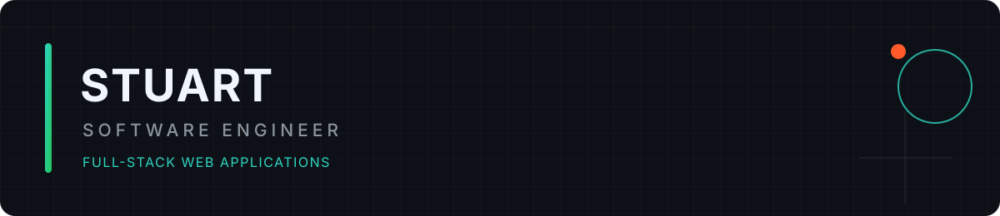

  

  <a href="https://stuart-shan.vercel.app">Portfolio</a> &middot;
  <a href="https://www.linkedin.com/in/shanthosh-saisangar14/">LinkedIn</a> &middot;
  <a href="https://github.com/Stuart-Vision?tab=repositories">All repositories</a>

I build full-stack applications for commerce, restaurant operations, and interactive digital experiences. My work focuses on clear business workflows, practical data models, and interfaces that are straightforward to use.

**Core stack:** TypeScript &middot; React &middot; Next.js &middot; Node.js &middot; MongoDB &middot; Laravel

## Selected work

<table>
  <tr>
    <td width="33%"></td>
    <td width="33%"></td>
    <td width="33%"></td>
  </tr>
  <tr>
    <td valign="top"><a href="https://github.com/Stuart-Vision/dineflow-pos"><strong>DineFlow POS</strong></a> Restaurant ordering, kitchen workflows, inventory, reporting, and role-based access. Next.js &middot; TypeScript &middot; MongoDB</td>
    <td valign="top"><a href="https://github.com/Stuart-Vision/Multivendor-ecommerce"><strong>Velora</strong></a> Multi-vendor commerce with seller dashboards, order processing, and commission accounting. Next.js &middot; Express &middot; MongoDB</td>
    <td valign="top"><a href="https://github.com/Stuart-Vision/MOTIONA"><strong>MOTIONA</strong></a> Responsive art discovery interface with scroll animation and reusable motion components. Next.js &middot; TypeScript &middot; Framer Motion</td>
  </tr>
</table>

## More projects

| Project | What it demonstrates |
| --- | --- |
| [EduManage](https://github.com/Stuart-Vision/eduman) | Laravel authentication, permissions, and role-based dashboards |
| [Gyra Real Estate](https://github.com/Stuart-Vision/Gyra-Real-Estate) | Property discovery, agent workflows, inquiries, and listing management |
| [Liza's Ribbon](https://github.com/Stuart-Vision/lizaG) | Product personalisation, custom orders, checkout, and order tracking |

## Engineering approach

- Model business rules explicitly, including permissions, pricing, inventory, and state transitions.
- Keep setup reproducible with documented environments, seed data, and verification commands.
- Treat responsive behavior, accessibility, and operational limits as part of the implementation.

Currently improving project documentation, demo walkthroughs, and automated checks.

**Technical notes:** [Velora design decisions](https://github.com/Stuart-Vision/Multivendor-ecommerce#design-decisions) &middot; [MOTIONA animation architecture](https://github.com/Stuart-Vision/MOTIONA#animation-architecture) &middot; [DineFlow roadmap](https://github.com/Stuart-Vision/dineflow-pos/blob/main/docs/ROADMAP.md)

